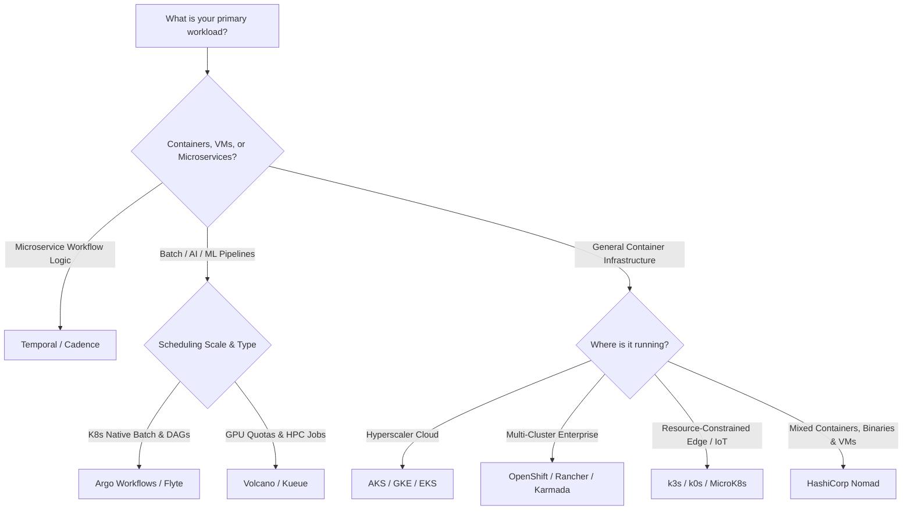

  

# 🚀 Awesome Workload Orchestration ☸️

  
  
  
  
  
  
  

> **A curated, production-tested directory of SaaS products, managed cloud control planes, open-source cluster schedulers, container runtimes, multi-cloud placement engines, and batch/AI workflow orchestrators.**

---

## 📌 Executive Summary & Scope

**Workload Orchestration** forms the fundamental runtime nervous system of modern cloud computing and enterprise IT. Modern orchestrators automate the entire operational lifecycle of mission-critical software—intelligently placing, provisioning, auto-scaling, health-checking, networking, and self-healing workloads across heterogeneous compute fleets (containers, virtual machines, bare metal, serverless functions, and distributed GPUs).

Whether you are deploying enterprise microservices across hybrid clouds, scheduling burstable AI/ML batch pipelines, or orchestrating low-footprint services across edge and IoT devices, this directory tracks both the leading commercial cloud offerings and the foundational open-source projects defining cloud-native infrastructure.

---

## 📑 Table of Contents

- [📊 Sector Overview \& Market Dynamics](#-sector-overview--market-dynamics)
- [☁️ SaaS \& Hosted Workload Orchestration Platforms](#️-saas--hosted-workload-orchestration-platforms)
- [🐙 Top Open-Source Workload Orchestration Projects](#-top-open-source-workload-orchestration-projects)
  - [1. Kubernetes](#1-kubernetes)
  - [2. Moby / Docker Engine \& Swarm](#2-moby--docker-engine--swarm)
  - [3. k3s](#3-k3s)
  - [4. Temporal](#4-temporal)
  - [5. Argo Workflows](#5-argo-workflows)
  - [6. Nomad](#6-nomad)
  - [7. Crossplane](#7-crossplane)
  - [8. Talos Linux](#8-talos-linux)
  - [9. MicroK8s](#9-microk8s)
  - [10. Flyte](#10-flyte)
  - [11. k0s](#11-k0s)
  - [12. Volcano](#12-volcano)
  - [13. Karmada](#13-karmada)
  - [14. Apache Mesos](#14-apache-mesos)
  - [15. Virtual Kubelet](#15-virtual-kubelet)
  - [16. Cluster API](#16-cluster-api)
  - [17. Kueue](#17-kueue)
  - [18. OKD](#18-okd)
  - [19. Open Cluster Management (OCM)](#19-open-cluster-management-ocm)
- [🧭 Architecture Decision Matrix](#-architecture-decision-matrix)
- [🛠️ How to Contribute](#️-how-to-contribute)
- [📈 Star History](#-star-history)
- [💖 Support \& Community](#-support--community)
- [📜 License \& Disclaimer](#-license--disclaimer)

---

## 📊 Sector Overview & Market Dynamics

The global container and workload orchestration market is experiencing rapid expansion, valued at **$2.7B to $3.2B in 2025/2026** and projected to climb past **$16.8B+ by 2035** at a compounding annual growth rate (CAGR) of **~20% to 31.8%** (with the broader cloud orchestration and infrastructure automation sector exceeding **$10.9B+**).

The sector is **highly concentrated and structurally winner-take-most**, anchored by **Kubernetes** as the undisputed industry standard capturing over **85%–90%** of enterprise containerized environments. Control-plane management is concentrated among the top hyperscalers (**Microsoft Azure AKS**, **Google Cloud GKE**, and **AWS EKS**), alongside enterprise distribution giants like **Red Hat OpenShift** and **SUSE Rancher**. Specialized alternatives such as **HashiCorp Nomad** and batch orchestrators thrive in high-efficiency niches, non-containerized legacy environments, and specialized AI/ML job scheduling.

---

## ☁️ SaaS & Hosted Workload Orchestration Platforms

The following table benchmarks the top commercial and fully managed workload orchestration platforms. Companies are sorted in **descending order by company size** (market capitalization / enterprise valuation).

| Platform / Product | Parent Company & Size 🏢 | Primary Orchestration Focus 🎯 | Specific Starting Tier Pricing 💵 | Free Tier Limit / Free Trial Details 🎁 |
| :--- | :--- | :--- | :--- | :--- |
| **[Azure Kubernetes Service (AKS)](https://azure.microsoft.com/en-us/products/kubernetes-service)** | **Microsoft** *(Market Cap: ~$3.12T)* | Managed Kubernetes with serverless virtual nodes, Azure Entra ID RBAC, and automated fleet management. | **$0.00/hr** cluster management on Standard clusters; AKS Automatic / Uptime SLA costs **$0.10/cluster/hr** (~$73/mo); underlying VMs from **$0.0416/hr** (B2s ~$30.37/mo). | **Free forever** cluster management on Standard tier. Azure Free Account grants **$200 credit for 30 days** + 12 months free access to 750 hrs/mo B1s/B2pts compute. |
| **[Google Kubernetes Engine (GKE)](https://cloud.google.com/kubernetes-engine)** | **Alphabet / Google** *(Market Cap: ~$2.15T)* | Managed Kubernetes with hands-off Autopilot mode, node auto-provisioning, and multi-zonal resilience. | **$0.10/cluster/hr** (~$73/mo) for Standard/Enterprise clusters; Autopilot charges **$0.000011/vCPU-sec** (~$0.04/vCPU-hr) and **$0.000001/GB-sec** (~$0.0036/GB-hr). | **Free forever $74.40/month billing credit** per account (covers 1 zonal or Autopilot cluster free forever). Google Cloud Free Tier also includes **$300 credit for 90 days**. |
| **[Amazon Elastic Kubernetes Service (EKS)](https://aws.amazon.com/eks/)** | **Amazon / AWS** *(Market Cap: ~$1.95T)* | Highly available, certified Kubernetes control plane deeply integrated with AWS VPC, IAM, EBS, and AWS Fargate. | **$0.10/cluster/hr** (~$73/mo per cluster control plane) + worker nodes via EC2 (e.g., `t4g.medium` from **$0.0336/hr**) or Fargate (**$0.04048/vCPU-hr** + **$0.004445/GB-hr**). | **No free forever control plane**; AWS Free Tier provides **750 hrs/month of t2.micro/t3.micro** compute for 12 months, plus startup/trial accounts receive **$300 cloud credits**. |
| **[VMware Tanzu Platform](https://tanzu.vmware.com/)** | **Broadcom** *(Market Cap: ~$820B)* | Enterprise multi-cloud container platform and multi-cluster policy governance via Tanzu Mission Control. | Tanzu Platform commercial subscriptions start at **~$130/core/year** (~$10.83/core/month) under Broadcom subscription licensing. | **30-day free trial** of VMware Tanzu Mission Control and Tanzu Platform with full multi-cluster management access. |
| **[Red Hat OpenShift (ROSA / ARO / Dedicated)](https://www.redhat.com/en/technologies/cloud-computing/openshift)** | **IBM / Red Hat** *(IBM Market Cap: ~$215B; Red Hat Rev: ~$6.5B)* | Enterprise-hardened Kubernetes distribution with integrated developer consoles, CI/CD pipelines, and compliance tooling. | ROSA starts at **$0.03/4-vCPU worker hr** (~$0.0075/vCPU-hr) + **$0.07/cluster/hr** on AWS; OpenShift Dedicated starts at **~$0.03/vCPU/hr** (~$171/cluster/month base). | **60-day free trial** evaluation license on Red Hat Hybrid Cloud Console with self-managed cluster deployment or **$500 cloud credits for 30 days**. |
| **[Nutanix Kubernetes Platform (NKP)](https://www.nutanix.com/products/kubernetes-platform)** | **Nutanix** *(Market Cap: ~$15.8B)* | Production-ready Kubernetes engine engineered for on-premises, hybrid, and air-gapped data centers. | Included with Nutanix Cloud Platform subscriptions or NKP stand-alone starting at **~$1,500/node/year** (~$125/node/month). | **30-day free trial** via Nutanix Test Drive cloud lab environment (pre-configured full enterprise cluster sandbox). |
| **[HashiCorp HCP Nomad](https://www.hashicorp.com/products/nomad)** | **HashiCorp / IBM** *(Valuation: ~$6.4B acquisition)* | Fully managed control plane for HashiCorp Nomad to schedule containers, legacy binaries, and batch workloads. | HCP Nomad Starter starts at **$0.015/client-hr** (~$10.95/client/month); Plus tier starts at **$0.05/client-hr** (~$36.50/client/month). | **$50 free credits** upon account signup (covers ~3,333 client-hours on Starter). Self-hosted Nomad Community Edition is **free forever**. |
| **[SUSE Rancher Prime](https://www.rancher.com/)** | **SUSE** *(Valuation: ~$2.5B; ARR: ~$650M)* | Multi-cluster Kubernetes management plane across public clouds, bare-metal clusters, and edge K3s nodes. | Commercial subscriptions start at **~$1,200/node/year** (~$100/node/month); cloud marketplace hourly pay-as-you-go starts at **$0.04/node/hour**. | **30-day free trial** with full Rancher Prime enterprise features; Rancher Community Open Source edition is **free forever**. |
| **[Mirantis Kubernetes Engine (MKE)](https://www.mirantis.com/software/mke/)** | **Mirantis** *(Valuation: ~$250M; ARR: ~$100M)* | Enterprise container platform supporting both Kubernetes and Docker Swarm with integrated container registry and FIPS 140-2 compliance. | Commercial enterprise licensing starts at **~$1,500/node/year** (~$125/node/month). | **30-day free trial** for up to 10 nodes including Mirantis Secure Registry and web management interface. |
| **[Platform9 Managed Kubernetes (PMK)](https://platform9.com/managed-kubernetes/)** | **Platform9 Systems** *(Valuation: ~$200M; Funding: ~$75M)* | SaaS-managed Kubernetes with remote 24/7/365 SLA monitoring, zero-touch upgrades, and bare-metal support. | Enterprise tier starts at **$60/node/month** (or **$0.082/node/hour**). | **Free forever tier** supporting up to **3 clusters and 20 nodes** with community support. |

---

## 🐙 Top Open-Source Workload Orchestration Projects

The following list features top open-source workload orchestrators, schedulers, and cluster runtimes, sorted in **descending order by GitHub star count**. Beside each project name is an interactive star badge linking directly to that repository's stargazers page.

---

### 1. [Kubernetes](https://github.com/kubernetes/kubernetes) 

- **Repository**: [kubernetes/kubernetes](https://github.com/kubernetes/kubernetes)
- **License**: Apache-2.0 ⚖️
- **Overview**: The universal industry standard for container orchestration. Kubernetes automates deployment, scaling, health-checking, service discovery, load balancing, and storage orchestration for containerized applications across compute clusters. Backed by CNCF and hundreds of global enterprises.
- **Key Capabilities**: Declarative YAML APIs, automated rollouts and rollbacks, horizontal and vertical pod autoscaling, secret and config management, and a vast ecosystem of Operators and CRDs.

---

### 2. [Moby / Docker Engine & Swarm](https://github.com/moby/moby) 

- **Repository**: [moby/moby](https://github.com/moby/moby)
- **License**: Apache-2.0 ⚖️
- **Overview**: The foundational open-source framework and container engine that revolutionized containerization. Includes **Docker Swarm Mode**, a native, lightweight clustering and workload scheduling mechanism built directly into Docker Engine.
- **Key Capabilities**: Zero-dependency orchestration for Docker users, decentralized consensus via Raft, declarative service definitions via Docker Compose files, built-in ingress routing mesh, and cryptographic node tokens.

---

### 3. [k3s](https://github.com/k3s-io/k3s) 

- **Repository**: [k3s-io/k3s](https://github.com/k3s-io/k3s)
- **License**: Apache-2.0 ⚖️
- **Overview**: A highly lightweight, certified Kubernetes distribution packaged as a single binary under 100MB. Engineered by Rancher/SUSE specifically for IoT, edge devices, branch offices, ARM single-board computers (Raspberry Pi), and CI environments.
- **Key Capabilities**: Replaces heavy etcd with SQLite/Postgres/MySQL options, strips out legacy cloud providers, packages containerd, Flannel CNI, CoreDNS, and Traefik ingress by default, and boots in seconds.

---

### 4. [Temporal](https://github.com/temporalio/temporal) 

- **Repository**: [temporalio/temporal](https://github.com/temporalio/temporal)
- **License**: MIT ⚖️
- **Overview**: An open-source, durable execution engine and code-first workload orchestrator. Temporal allows developers to orchestrate complex, fault-tolerant business workflows, async jobs, and microservice transactions as plain code (Go, Java, Python, TypeScript, .NET).
- **Key Capabilities**: Guarantees workflow completion despite server crashes or network outages, eliminates manual retry and compensation queue logic, provides event-sourced state machines, and scales to millions of concurrent executions.

---

### 5. [Argo Workflows](https://github.com/argoproj/argo-workflows) 

- **Repository**: [argoproj/argo-workflows](https://github.com/argoproj/argo-workflows)
- **License**: Apache-2.0 ⚖️
- **Overview**: A container-native workflow and batch job engine designed specifically for Kubernetes. CNCF Graduated project that schedules complex Directed Acyclic Graph (DAG) pipelines where each task runs inside its own isolated Kubernetes container.
- **Key Capabilities**: Native Kubernetes CRD implementation, DAG and step-based pipelines, artifact management (S3, GCS), high-throughput parallel compute scheduling for ETL, data processing, and machine learning pipelines.

---

### 6. [Nomad](https://github.com/hashicorp/nomad) 

- **Repository**: [hashicorp/nomad](https://github.com/hashicorp/nomad)
- **License**: BSL-1.1 ⚖️
- **Overview**: A simple, flexible, and high-performance workload orchestrator from HashiCorp. Unlike Kubernetes, Nomad natively schedules both containerized (Docker, Podman) and non-containerized workloads (raw binaries, Java JARs, QEMU/KVM virtual machines) across bare-metal and multi-cloud nodes.
- **Key Capabilities**: Single binary architecture without complex etcd clusters, scales easily to 10,000+ nodes in production, native integration with HashiCorp Consul (service mesh) and Vault (secrets management), and declarative HCL job specifications.

---

### 7. [Crossplane](https://github.com/crossplane/crossplane) 

- **Repository**: [crossplane/crossplane](https://github.com/crossplane/crossplane)
- **License**: Apache-2.0 ⚖️
- **Overview**: A CNCF cloud-native control plane framework that transforms Kubernetes into a universal control plane for orchestrating infrastructure, databases, and multi-cloud services alongside application workloads.
- **Key Capabilities**: Declarative cloud resource management via Kubernetes CRDs, custom composite API creation without writing Go code, continuous reconciliation to prevent drift, and elimination of fragmented IaC pipeline runs.

---

### 8. [Talos Linux](https://github.com/siderolabs/talos) 

- **Repository**: [siderolabs/talos](https://github.com/siderolabs/talos)
- **License**: MPL-2.0 ⚖️
- **Overview**: A modern, immutable, and secure Linux OS designed specifically for running Kubernetes. Talos strips out systemd, shells, SSH, and console utilities to produce a tiny (<100MB) attack-proof substrate managed entirely via a secure gRPC API.
- **Key Capabilities**: Immutable root filesystem, declarative configuration via YAML, automated atomic node upgrades, zero SSH access by design, and optimized specifically for cloud, virtualization, and bare-metal Kubernetes clusters.

---

### 9. [MicroK8s](https://github.com/canonical/microk8s) 

- **Repository**: [canonical/microk8s](https://github.com/canonical/microk8s)
- **License**: Apache-2.0 ⚖️
- **Overview**: Canonical's zero-ops, pure upstream Kubernetes distribution packaged as a snap package. Ideal for local developer workstations, IoT gateways, edge appliances, and lightweight production clusters.
- **Key Capabilities**: One-command installation (`snap install microk8s`), built-in add-on marketplace (`microk8s enable ingress dns dashboard gpu`), automatic self-healing dqlite high availability, and native Ubuntu/Debian/macOS/Windows support.

---

### 10. [Flyte](https://github.com/flyteorg/flyte) 

- **Repository**: [flyteorg/flyte](https://github.com/flyteorg/flyte)
- **License**: Apache-2.0 ⚖️
- **Overview**: A production-grade, highly scalable workflow orchestrator for machine learning, data engineering, and distributed analytics pipelines, originally developed at Lyft and maintained under the LF AI & Data Foundation.
- **Key Capabilities**: Type-safe workflows in Python, reproducible execution caching, multi-tenant execution tracking, Kubernetes-native container isolation, and integration with Ray, Spark, and PyTorch distributed jobs.

---

### 11. [k0s](https://github.com/k0sproject/k0s) 

- **Repository**: [k0sproject/k0s](https://github.com/k0sproject/k0s)
- **License**: Apache-2.0 ⚖️
- **Overview**: A frictionless, single-binary Kubernetes distribution from Mirantis with zero host OS dependencies. Engineered for simplicity, edge computing, bare metal, and air-gapped secure installations.
- **Key Capabilities**: Pure single executable packaging, bundled etcd with automated backup/restore, decoupled control plane from worker nodes, FIPS compliance options, and sub-minute cluster provisioning.

---

### 12. [Volcano](https://github.com/volcano-sh/volcano) 

- **Repository**: [volcano-sh/volcano](https://github.com/volcano-sh/volcano)
- **License**: Apache-2.0 ⚖️
- **Overview**: A CNCF batch scheduling and workload orchestration system specifically tailored for high-performance computing (HPC), AI/ML model training (TensorFlow, PyTorch), and big data frameworks (Spark, Flink) on Kubernetes.
- **Key Capabilities**: Gang scheduling, fair-share queue allocation, bin-packing, GPU resource topology-aware scheduling, SLA-driven preemption, and job lifecycle management for large-scale compute workloads.

---

### 13. [Karmada](https://github.com/karmada-io/karmada) 

- **Repository**: [karmada-io/karmada](https://github.com/karmada-io/karmada)
- **License**: Apache-2.0 ⚖️
- **Overview**: CNCF multi-cloud, multi-cluster Kubernetes workload orchestration engine. Karmada enables native Kubernetes applications to run across distributed, heterogeneous clusters without code changes.
- **Key Capabilities**: Centralized multi-cluster API endpoint, automated cross-cluster failover and auto-scaling, dynamic traffic governance, multi-region workload scheduling policies, and zero disruption to member clusters.

---

### 14. [Apache Mesos](https://github.com/apache/mesos) 

- **Repository**: [apache/mesos](https://github.com/apache/mesos)
- **License**: Apache-2.0 ⚖️
- **Overview**: A legendary distributed systems kernel that abstracts CPU, memory, storage, and GPU resources across physical or virtual machines. Historically powered massive scale infrastructure at Twitter, Airbnb, and Apple.
- **Key Capabilities**: Two-level resource scheduling model via dynamic resource offers, linear scalability to tens of thousands of cluster nodes, multi-framework sharing (Marathon, Chronos, Spark), and fine-grained resource isolation with Linux cgroups.

---

### 15. [Virtual Kubelet](https://github.com/virtual-kubelet/virtual-kubelet) 

- **Repository**: [virtual-kubelet/virtual-kubelet](https://github.com/virtual-kubelet/virtual-kubelet)
- **License**: Apache-2.0 ⚖️
- **Overview**: An open-source Kubernetes kubelet implementation that masks other APIs as standard Kubernetes nodes. Powers serverless container engines like AWS Fargate, Azure Container Instances (ACI), and HashiCorp Nomad integrations.
- **Key Capabilities**: Enables infinite-capacity serverless pod bursting without managing node VMs, custom provider pluggability, reduced control plane resource overhead, and seamless integration with the standard Kubernetes scheduler.

---

### 16. [Cluster API](https://github.com/kubernetes-sigs/cluster-api) 

- **Repository**: [kubernetes-sigs/cluster-api](https://github.com/kubernetes-sigs/cluster-api)
- **License**: Apache-2.0 ⚖️
- **Overview**: A Kubernetes Special Interest Group (SIG) project that brings declarative, Kubernetes-style APIs to cluster creation, configuration, and management across AWS, Azure, GCP, VMware, and bare metal.
- **Key Capabilities**: Treats Kubernetes clusters as custom resources (`Cluster`, `Machine`, `MachineDeployment`), simplifies multi-cluster fleet lifecycle, and automates rolling upgrades of control planes and worker nodes.

---

### 17. [Kueue](https://github.com/kubernetes-sigs/kueue) 

- **Repository**: [kubernetes-sigs/kueue](https://github.com/kubernetes-sigs/kueue)
- **License**: Apache-2.0 ⚖️
- **Overview**: A Kubernetes-native job queueing controller that manages quotas, priorities, and admission for batch, AI/ML, and distributed training jobs (Ray, Kubeflow, MPI, JobSet).
- **Key Capabilities**: Resource cohort sharing, dynamic quota borrowing across teams, prioritized queuing to prevent cluster over-subscription, and native compatibility with upstream Kubernetes Batch APIs.

---

### 18. [OKD](https://github.com/okd-project/okd) 

- **Repository**: [okd-project/okd](https://github.com/okd-project/okd)
- **License**: Apache-2.0 ⚖️
- **Overview**: The open-source community distribution of Kubernetes that powers Red Hat OpenShift. Combines upstream Kubernetes with continuous deployment tooling, security policies, and container image registries.
- **Key Capabilities**: Built-in developer web console, Source-to-Image (S2I) automated build pipelines, integrated Prometheus/Grafana monitoring, Tekton CI/CD integration, and Fedora CoreOS immutable host substrate.

---

### 19. [Open Cluster Management (OCM)](https://github.com/open-cluster-management-io/ocm) 

- **Repository**: [open-cluster-management-io/ocm](https://github.com/open-cluster-management-io/ocm)
- **License**: Apache-2.0 ⚖️
- **Overview**: A CNCF Sandbox project designed for modular, scalable multi-cluster fleet management and policy enforcement across hybrid and multi-cloud Kubernetes deployments.
- **Key Capabilities**: Hub-and-spoke cluster architecture, `Placement` APIs for intelligent workload distribution, policy-driven security enforcement, and integration with GitOps tools like Argo CD.

---

## 🧭 Architecture Decision Matrix

Use this quick guide to choose the right workload orchestration engine for your infrastructure:

| Use Case | Recommended Solution | Rationale |
| :--- | :--- | :--- |
| **Enterprise Standard Microservices** | **Kubernetes (AKS / GKE / EKS)** | Unbeatable ecosystem, talent availability, vendor support, and vast tooling integration. |
| **Edge, Single-Board Computers & IoT** | **k3s / k0s / MicroK8s** | Single-binary footprint (<100MB), minimal RAM overhead, and rapid cold boot times. |
| **Mixed Workloads (Binaries, VMs & Containers)** | **HashiCorp Nomad** | Simpler operations than Kubernetes; natively schedules raw execs, Java, and QEMU VMs. |
| **Complex Distributed App Workflows** | **Temporal** | Code-first stateful durable execution; handles retries, queues, and distributed transactions. |
| **Multi-Cloud Multi-Cluster Federation** | **Karmada / OCM** | Centralized policy-based placement and automated failover across disparate cloud clusters. |
| **AI/ML & HPC Batch Job Queuing** | **Volcano / Kueue / Argo Workflows** | Gang-scheduling, GPU sharing, resource borrowing, and type-safe DAG execution. |

---

## 🛠️ How to Contribute

Contributions are warmly welcome! Help keep this directory current, accurate, and comprehensive:

1. **Fork this repository** on GitHub.
2. **Create a descriptive feature branch** (`git checkout -b add-my-orchestration-tool`).
3. **Add or update entries in `README.md`**:
   - Ensure SaaS entries include specific starting tier pricing and exact free tier/trial limits.
   - Ensure Open-Source entries include a valid White Social badge linking to the stargazers page.
   - Keep descriptions factual, concise, and focused on architectural strengths.
4. **Commit your modifications** with a clear message (`git commit -m 'feat: add XYZ orchestrator'`).
5. **Submit a Pull Request** against the `main` branch with a brief rationale.

> Check out our comprehensive collection of awesome lists at [Awesome-Awesome-Awesome](https://github.com/ishandutta2007/Awesome-Awesome-Awesome)!

---

## 📈 Star History

---

## 💖 Support & Community

Thank you so much for exploring the **Awesome Workload Orchestration** repository! If you find this directory valuable for your cloud-native infrastructure, DevOps pipelines, or distributed systems architecture, please consider supporting the project:

- ⭐ **Star this repository** on GitHub to help other engineers discover it!
- 🍴 **Fork the repo** to contribute new workload orchestrators, schedulers, and edge platforms.
- 📢 **Share with your colleagues, DevOps teams, and platform engineering communities.**
- ☕ **Buy a coffee & sponsor ongoing maintenance:** Support the creator directly via the [GitHub Sponsor Dashboard](https://github.com/sponsors/ishandutta2007). Your sponsorship fuels continuous curation and ecosystem research!

---

## 📜 License & Disclaimer

- **License**: Released under the [MIT License](https://github.com/ishandutta2007/Awesome-Workload-Orchestration/blob/main/LICENSE).
- **Disclaimer**: This list is community-curated for informational and educational purposes. Mention of commercial products or open-source projects does not constitute an official endorsement. Workload orchestrators govern live production infrastructure; always harden RBAC, network security policies, and cluster admission controls in production.

---

  <b>Built with ❤️ for platform engineers, SREs, and cloud-native architects.</b>

